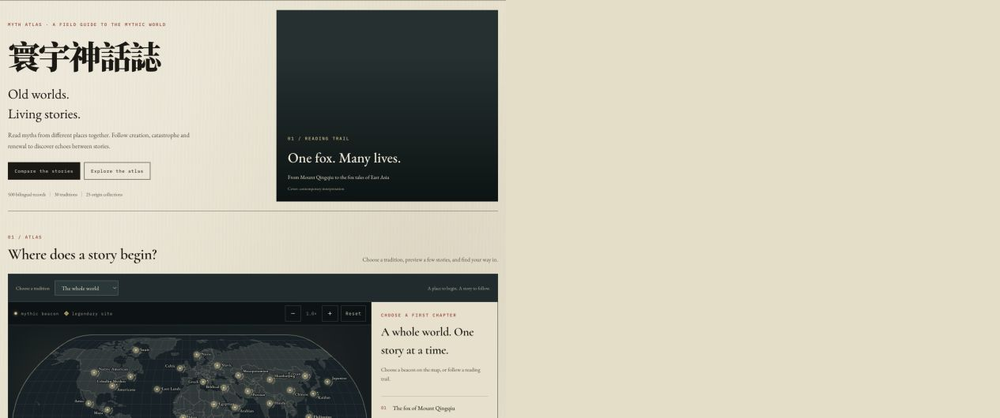
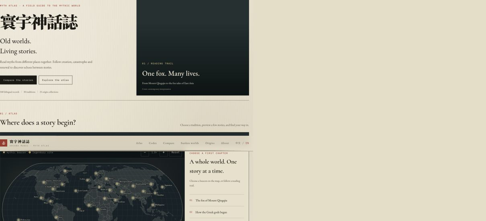
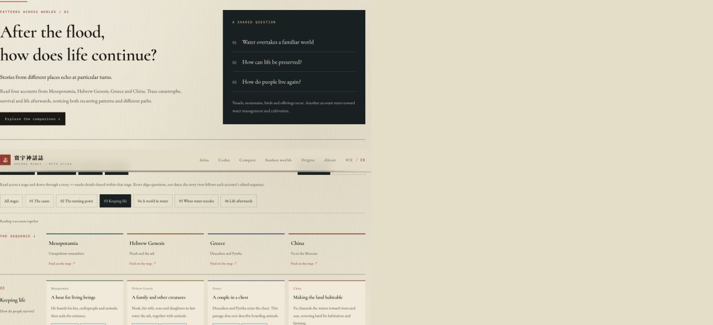

<h1 align="center">Myth Atlas</h1>

<p align="center">
  <strong>An interactive atlas of myths, creatures, and lost worlds.</strong><br>
  Explore places, search the collection, and read stories from different traditions side by side.
</p>

<p align="center">
  <a href="https://myth-atlas.vercel.app/en"><strong>Explore the live site</strong></a>
  &nbsp; · &nbsp;
  <a href="https://myth-atlas.vercel.app/en/compare">Compare stories</a>
  &nbsp; · &nbsp;
  <a href="https://yichenwu.dev/projects/myth-atlas">Project overview</a>
</p>

<a href="https://myth-atlas.vercel.app/en">
  
</a>

<p align="center">
  <strong>500 bilingual records</strong> &nbsp; / &nbsp;
  <strong>30 traditions and collections</strong> &nbsp; / &nbsp;
  <strong>25 origin collections</strong><br>
  <sub>English and Chinese · Live website · Ongoing personal project</sub>
</p>

## Explore the atlas

Start with a place on the map, look up a creature, or follow a question across several stories.

| Explore by place | Read across traditions |
| :--- | :--- |
| [](https://myth-atlas.vercel.app/en#atlas) | [](https://myth-atlas.vercel.app/en/compare#narratives) |
| **Interactive world map.** Choose a tradition and preview stories before opening a record. | **Side-by-side reading.** Compare specific accounts by shared questions, with their differences and source references visible. |

- **Search the collection.** Find gods, creatures, places, and legends by name, including original-language names, then filter by tradition, type, or era.
- **Follow a reading trail.** Explore East Asian fox stories, creation narratives, or the accounts of Mu and Atlantis.
- **Switch languages as you explore.** English and Chinese views preserve the current reading or map context.
- **Inspect the sources.** Records include references and image credits; original editorial illustrations are identified separately from archival material.

## Built with AI assistance

I built Myth Atlas to explore how far I could take a complete website with AI assistance: implementation, bilingual content collection, and selected illustrations.

My work connects those parts into a usable product: defining the browsing experience, organizing the content schema, directing AI-assisted development and content workflows, and integrating search, maps, and source attribution. The repository includes validation scripts and regression tests to support that work.

AI-assisted text still needs source review. Generated artwork is presented as a contemporary interpretation, not historical evidence.

## Under the hood

**Next.js · React · TypeScript · Tailwind CSS · D3 · MiniSearch**

- **Content as data:** one JSON file per entry, with shared metadata for traditions. Pages, filters, and search data are generated from the collection.
- **Interactive geography:** D3 renders the world map; URL state keeps the selected tradition, story, and zoom available when navigating.
- **Multilingual retrieval:** search handles Latin text and CJK names, with focused tests for ranking and navigation context.
- **Traceable imagery:** import scripts retain artwork sources, attribution, and provenance alongside each record.

## Run locally

Use **Node.js 22.18 or newer**.

```bash
npm ci
npm run dev
```

Open [localhost:3000](http://localhost:3000). For a production preview:

```bash
npm run build
npm start
```

<details>
<summary><strong>Validation and tests</strong></summary>

```bash
npm run validate
npm run audit
npm run lint
npm test
npm run build
```

Validation checks the content schema. The audit checks content and image consistency. Tests cover search, navigation context, and narrative branches. GitHub Actions runs these checks on pushes to `main` and on pull requests.

When checking interactions on Node.js 25, use the production preview; development-mode hydration issues have previously been observed in that environment.

</details>

## Documentation

- [Project architecture and workflows](docs/PROJECT.md)
- [Content schema and editorial guide](docs/CONTENT_GUIDE.md)

Images and source material retain their individual attribution and usage terms. See the credits on each entry before reusing them.

---

Created by [Yichen Wu](https://yichenwu.dev) · [Explore Myth Atlas](https://myth-atlas.vercel.app/en)
